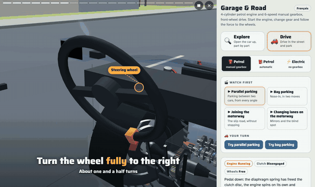
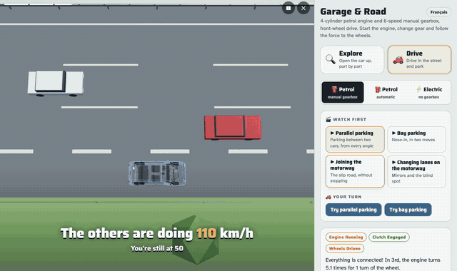
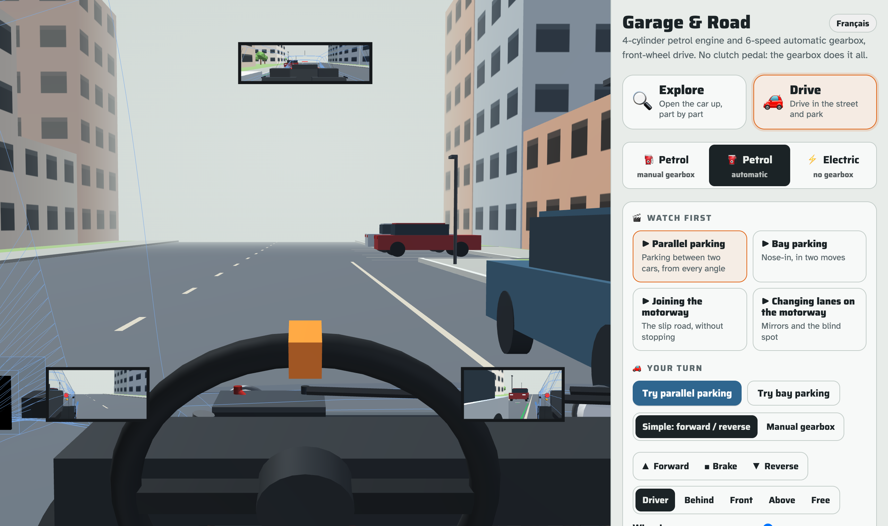
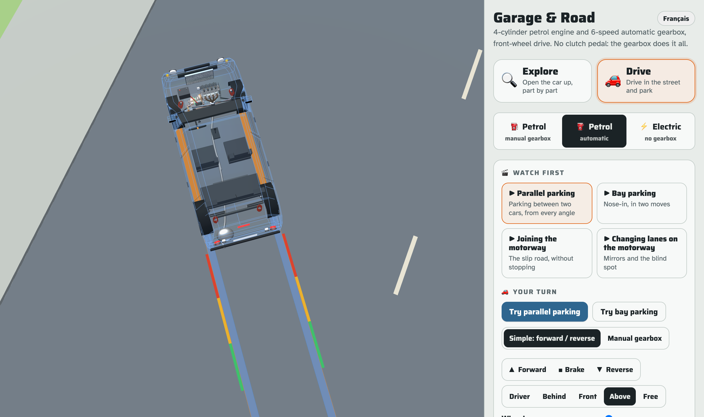

# Garage & Route 🚗

**Open a car up to see how it works. Then watch how to drive it, and try.**

👉 **[Open the page](https://cornelcroi.github.io/how-a-car-works/)**. Works on a phone. No account, nothing to install.

English and French. The page picks your browser language. Switch with the button at the top of the panel, or force it with `?lang=en` / `?lang=fr`.


## What is it?

A 3D car for teenagers, learner drivers and anyone curious. It started with one question from a parent: *"how do I explain to my son what happens when you press the clutch and change gear?"*

Two tabs:

- **🔍 Explore**: the car is cut open. Start the engine, press the clutch, shift gears, and watch every part move. Tap any part to learn what it does.
- **🚗 Drive**: short videos that show a manoeuvre from every angle (parking, joining the motorway, changing lanes), then you try it yourself in a street.

Three cars share the scene:

- **Petrol, manual gearbox**: 4-cylinder engine, clutch, 6-speed manual.
- **Petrol, automatic**: same engine, torque converter, 6-speed planetary automatic.
- **Electric**: battery, inverter, permanent-magnet motor, single-speed reducer.

A small physics simulation drives everything. Press the clutch and the disc really lets go. Shift into 2nd and the selector collar really locks the gear. Release the clutch too fast and the engine stalls.

It's a **simplified model for learning**, not a repair manual and not a driving course.

## 🔍 Explore

- **Drive the cut-open car.** Start, clutch, gears, brake. The rev counter, the sound and every part react.

  

- **Look inside.** Every part is labelled. Turn the car, zoom in, show the body as a wireframe or hide it.

  

- **🎬 Show me.** Short videos that direct themselves: the camera moves, a pointer shows the part, captions explain. One idea per video: why the car doesn't move in neutral, pulling away without stalling, changing gear, engine braking, the 4 strokes, P-R-N-D, how an electric car moves, regenerative braking, why an electric car has no gearbox.

  

- **⚡ Electric.** Same scene, different car: battery, inverter, motor, one gear.

  

## 🚗 Drive

### Watch first

Each video breaks a manoeuvre into steps and shows every step from several places: from above, from behind, from the pavement, from the driver's seat with the three mirrors.

- **Parallel parking.** The steering wheel turns about one and a half turns, the front wheels follow (the inner one turns more), tyre tracks stay on the road, rear-camera guide lines show where you'll go.

  

- **Bay parking**, nose-in, in two moves: in at an angle, back up towards the car on your left, then straight in.
- **Joining the motorway.** Down the slip road, speed up to 110 on the acceleration lane, mirror, shoulder check, let the car in your blind spot pass, merge. And why you must never stop at the end.

  

- **Changing lanes on the motorway.** What each mirror shows (in green), the blind spot (in red), a car that vanishes from the mirror while it's still there.

### Your turn

Then drive the same car in a street with parked cars, kerbs and buildings, and park it in the green space.



| Do this | Keys | Phone |
|---|---|---|
| Go forward | hold `↑` | hold **▲ Forward** |
| Reverse | hold `↓` | hold **▼ Reverse** |
| Brake | `Space` (the car also stops when you let go) | hold **■ Brake** |
| Steer | hold `←` `→` (the wheel comes back to centre) | the **Wheel** slider |
| Change view | `V` | Driver · Behind · Front · Above · Free |

- **Simple gearbox** by default: forward, reverse, brake. Switch to **Manual gearbox** to practise with the clutch, stalls included.
- **Mirrors** in the driver's view, **parking sensors** that beep faster as you get close, **bumps** if you touch a car or the kerb.



## Where this could go

This is a showcase, built in a few days. But the engine underneath is the interesting part: **one car, one scene, and a director that can show any situation from any angle**. A new video is a list of shots, not a 3D project. A few directions I see:

- **Driving schools.** One short video per lesson ("today: hill start, parking, joining the motorway"), sent before the lesson. The student arrives knowing what the manoeuvre looks like from outside the car, which you can't see from the driver's seat.
- **Driving theory apps.** The theory test is a slideshow of photos. Here every question can be a scene: the same crossroads seen from the driver's seat, from above, from the cyclist. Two or three car models and a few streets are enough to generate hundreds of situations.
- **Garages.** Plug an OBD-II reader, read the fault code, light up the part in 3D. `P0301` (misfire, cylinder 1) → cylinder 1 and its spark plug glow, with an explanation the customer or a junior mechanic understands. The standard `P0xxx` codes map to parts with a lookup table, no model needed. Real car models and brand-specific codes are a different story: that data is licensed by the manufacturers.
- **Road safety campaigns.** Blind spots of a lorry, stopping distances at 50 / 90 / 130 km/h, overtaking a cyclist at 1 m in town and 1.5 m outside. Things everyone has read about and few have seen.

What it is not: a driving simulator. The physics is simple on purpose, the streets are toy streets. The value is in **seeing**, not in realism.

If one of these is your problem, or you see another one, open an issue or reach out.

## Make more videos

A video is a **list of shots**: which part to aim at, where the camera is, what the car does, and which caption to show. No 3D work.

```js
{id:'enginebrake', t:tr('Le frein moteur','Engine braking'), d:tr('…','Lifting off in gear slows the car'), shots:()=>[
  {focus:'pistons', iso:ENGINE_SHOT, dir:[1,0.35,-0.75], zoom:[1.4,1.0], dur:5.5,
   cap:tr('On lève le pied…','You lift off: the wheels now *turn* the engine'),
   at:[[0.3,()=>{ anim.gas={to:0,rate:3}; }]]},
  // …
]},
```

Every caption is written in both languages with `tr(french, english)`. Driving videos add a planned path (`park:k` plays step k of a manoeuvre, `pose:k` holds it), fixed cameras (`cam:{p, t}`, in the street or mounted on the car), and for the motorway the positions of the other cars, shot by shot.

- Shot format and actions: [docs/SCENARIOS.md](docs/SCENARIOS.md)
- Part keys: [docs/PARTS.md](docs/PARTS.md)
- Guide for coding assistants (Claude Code, Codex…): [CLAUDE.md](CLAUDE.md)

The easy way: clone the repo and ask your assistant. *"Add a Show me video that explains why you press the clutch before stopping."* Then check the mechanics are true: if a caption says the wheels are still, they must be still in the simulation.

## Run it locally

```bash
npm install && npx playwright install chromium   # once, for the tests
npm run build    # src/ → index.html
npm test         # checks the page loads, videos play and the car drives, in both languages
npm run serve    # http://localhost:8080
npm run capture  # regenerate the screenshots and GIFs in docs/media (needs ffmpeg)
```

Always edit `src/`, then build. `index.html` is generated and committed, because GitHub Pages serves it directly.

## How it's made

One static HTML file. [three.js](https://threejs.org/) for 3D, a small physics simulation for the rest (engine torque curve, clutch, torque converter, electric motor, regenerative braking, drag). No framework, no bundler, no server.

- The gears really mesh, tooth against tooth.
- The automatic follows a real Lepelletier planetary layout with chosen tooth counts.
- The manual ratios are approximate. The electric values are typical for a 2017 compact EV.
- Steering follows the Ackermann geometry. Parking paths use a simple bicycle model and are checked so the car never touches the parked cars.
- The body is a generic compact hatchback. No real brand or model.

Built in conversation with **Claude** (Anthropic) through Claude Code: I directed, Claude wrote the code, the tests and the docs.

## Roadmap

1. More driving videos: stopping distance and the 2-second rule, overtaking a cyclist, a lorry's blind spots, yield to the right.
2. Videos as plain JSON (`scenarios/*.json`), then a small command API and an MCP server, so an assistant can direct the page live.
3. A "type a fault code" mode on the generic car.

## About me

I'm **Corneliu Croitoru**. Staff GenAI Solutions Architect at Betclic, before that seven years at AWS (Solutions Architect, then Senior GenAI Prototyping Architect, 30+ GenAI prototypes with customers across EMEA). Twenty years of shipping software. The last few, shipping with AI.

I co-founded [StreetLens](https://streetlensapp.com), GPS audio guides written and narrated in eight languages, and [Back From My Trip](https://backfrommytrip.com). I co-authored [Agent Squad](https://github.com/awslabs/agent-squad), an open-source multi-agent framework.

This project is what I do when a real question comes up at home: build the smallest thing that answers it, and see if it's useful to others.

- GitHub: [@cornelcroi](https://github.com/cornelcroi)
- LinkedIn: [corneliucroitoru](https://www.linkedin.com/in/corneliucroitoru)

## Licence

MIT. Free to reuse, change and share.

---

### En français

**Garage & Route** : ouvre une voiture en 3D pour comprendre comment elle marche, regarde comment se garer ou s'insérer sur l'autoroute sous tous les angles, puis prends le volant et gare-toi dans la rue. Thermique (boîte manuelle ou auto) et électrique. La page est en français et en anglais (bouton en haut du panneau, ou `?lang=fr`).
