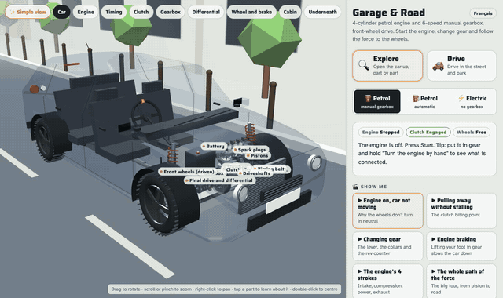
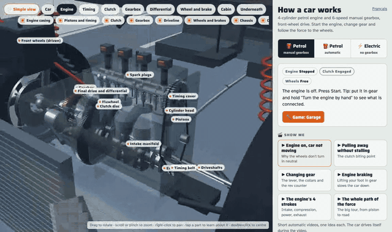
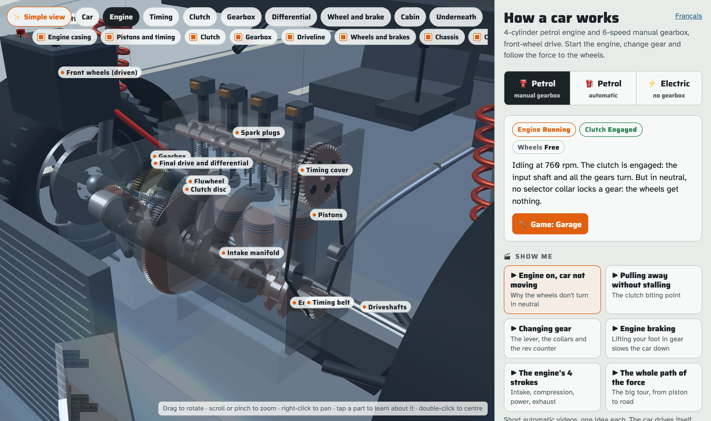
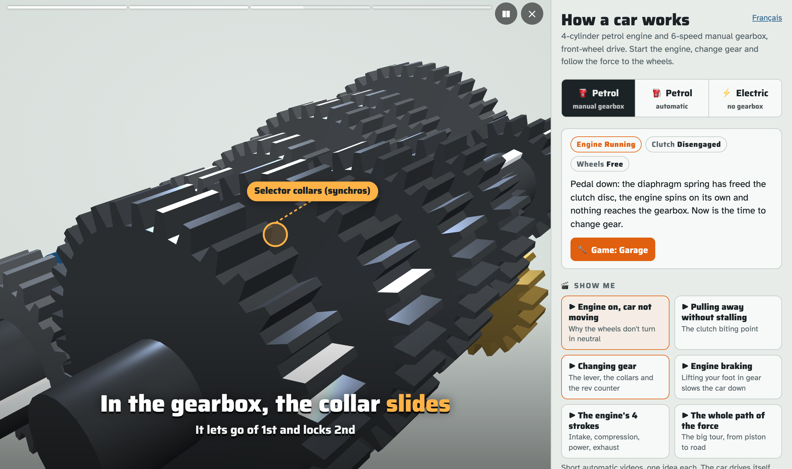
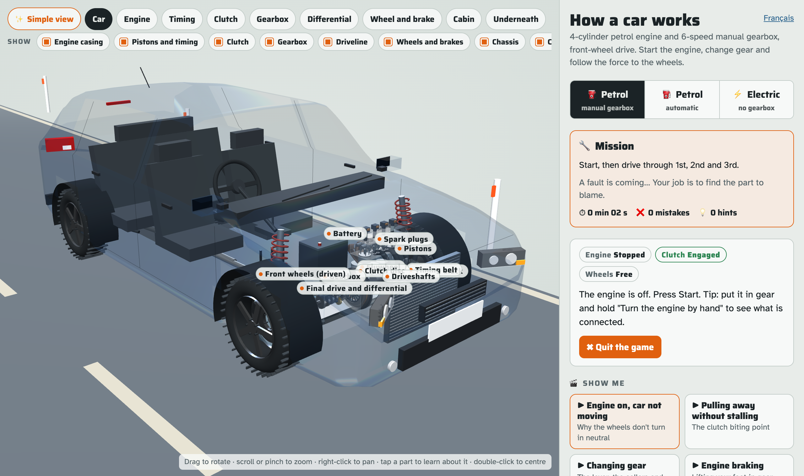
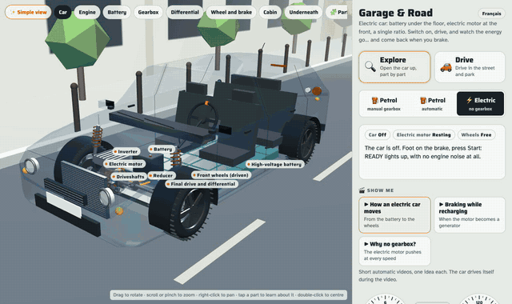

# How a car works 🚗

**An interactive 3D car you can drive, open up and take apart. See what happens from the piston to the road.**

👉 **[Open the page](https://cornelcroi.github.io/how-a-car-works/)**. Works on a phone. No account, nothing to install.

English and French. The page picks your browser language. Switch with the button at the top of the panel, or force it with `?lang=en` / `?lang=fr`.



## What is it?

It's a 3D model of a car for teenagers, learner drivers and anyone curious. It shows three cars in one scene:

- **Petrol, manual gearbox**: 4-cylinder engine, clutch, 6-speed manual.
- **Petrol, automatic**: same engine, torque converter, 6-speed planetary automatic.
- **Electric**: battery, inverter, permanent-magnet motor, single-speed reducer.

Everything moves together, driven by a small physics simulation. Press the clutch and the disc really lets go. Shift into 2nd and the selector collar really locks the gear. Stall the engine and it really stops.

It's a **simplified model for learning**, not a repair manual.

## What you can do

- **Drive.** Start the engine, use the clutch, shift gears, brake. The rev counter, the sound and every part react. You can stall it.

  

- **Look inside.** Every part is labelled. Turn the car, zoom in, hide the body.

  
- **Tap any part** (piston, spark plug, clutch disc, selector collar, inverter…) to see what it does. **Show alone** isolates it. Zoom goes where you point.
- **🎬 Show me.** Short videos that direct themselves: the camera moves, a pointer shows the part and captions explain. Each video covers one idea:
  - Engine running but the car doesn't move: why?
  - Pulling away without stalling
  - Changing gear
  - Engine braking
  - The 4 strokes of the engine
  - P, R, N, D in an automatic
  - How an electric car moves
  - Braking while recharging
  - Why an electric car has no gearbox
  
- **✨ Simple view.** Only engine, gearbox and wheels, so you can follow the force.
- **Your turn.** A guided lesson: step-by-step tasks that tick off as you do them.
- **🔧 Garage game.** A fault appears (spark plug, belt, battery, clutch, driveshaft, inverter…). Inspect, find the part, repair it, get your stars.

  

- **⚡ Electric.** Same scene, different car: battery, inverter, motor, one gear.

  

## How to explore

| Do this | How |
|---|---|
| Rotate | Drag |
| Zoom | Scroll or pinch (zooms where you point) |
| Pan | Right-click and drag |
| Centre on a part | Double-click |
| Learn about a part | Tap it |
| Start / stop | **Start** button or `K` |
| Clutch / brake / accelerator | Tap the pedals, or `C`, `F` / `↓`, `A` / `↑` |
| Gears (manual) | `1`–`6`, `R`, `N`. Clutch down first, or it grinds. |
| Selector (auto, electric) | `P`, `R`, `N`, `D`. Foot on the brake to leave P. |

Good first steps:
1. Pick **Petrol, manual**, press **Start**, then watch the crankshaft and pistons in the **Engine** view.
2. Press the clutch, select 1st, release slowly with a little throttle. Watch the clutch disc grip.
3. Switch to **Electric** and compare: no clutch, no gearbox, full push from 0 rpm.
4. Play **Garage** once you know the parts.

Real engines spin far too fast to see, so the parts move in slow motion (÷5, ÷20, ÷60). The dials always show real speeds.

## Make more videos

A video is just a **list of shots**: which part to aim at, what to show, what the car does (clutch in, shift to 2nd…) and which caption to show. No 3D work.

```js
{id:'enginebrake', t:tr('Le frein moteur','Engine braking'), d:tr('…','Lifting off in gear slows the car'), shots:()=>[
  {focus:'pistons', iso:ENGINE_SHOT, dir:[1,0.35,-0.75], zoom:[1.4,1.0], dur:5.5,
   cap:tr('On lève le pied…','You lift off: the wheels now *turn* the engine'),
   at:[[0.3,()=>{ anim.gas={to:0,rate:3}; }]]},
  // …
]},
```

Every caption is written in both languages with `tr(french, english)`.

- Shot format and available actions: [docs/SCENARIOS.md](docs/SCENARIOS.md)
- Part keys you can aim at: [docs/PARTS.md](docs/PARTS.md)
- Guide for coding assistants (Claude Code, Codex…): [CLAUDE.md](CLAUDE.md)

The easy way: ask an assistant. *"Add a Show me video that explains why you press the clutch before stopping."* It has everything it needs. Then check the mechanics are true: if a caption says the wheels are still, they must be still in the simulation.

Ideas waiting to be written: hill starts, why the engine screams in 1st at 50 km/h, reverse, eco-driving (shift early), dashboard warning lights, charging and range in the cold.

## Run it locally

```bash
npm install && npx playwright install chromium   # once, for the tests
npm run build    # src/ → index.html
npm test         # checks the page loads and videos play, in both languages
npm run serve    # http://localhost:8080
npm run capture  # regenerate the screenshots and GIFs in docs/media (needs ffmpeg)
```

Always edit `src/`, then build. `index.html` is generated and committed, because GitHub Pages serves it directly.

## How it's made

One static HTML file. [three.js](https://threejs.org/) for 3D, a small physics simulation for the rest (engine torque curve, clutch, torque converter, electric motor, regenerative braking, drag). No framework, no bundler.

- The gears really mesh, tooth against tooth.
- The automatic follows a real Lepelletier planetary layout with chosen tooth counts.
- The manual ratios are approximate. The electric values are typical for a 2017 compact EV.
- The body is a generic compact hatchback. No real brand or model.

It was built in conversation with **Claude** (Anthropic), starting from a parent's question: *"how do I explain to my son what happens when you start the car and shift gears?"*

## Roadmap

1. More learner-driver videos (list above).
2. Videos as plain JSON (`scenarios/*.json`), so assistants can write them without touching JS.
3. A small command API for the director (`focus`, `isolate`, `zoom`, `caption`), then an MCP server, so an assistant can drive the page live: *"show me the clutch"*.
4. A hybrid car, and a short quiz after each video.

### Idea: real car models and OBD for garages

Plug an OBD-II reader into a car, read the fault codes, and light up the faulty part in 3D. `P0301` (cylinder 1 misfire) → cylinder 1 and its spark plug glow, with an explanation the customer understands.

What's cheap and honest:
- **Generic codes on the generic car.** The standard `P0xxx` codes map to parts with a lookup table, not a model. The Garage game already highlights parts and explains faults. A "type or scan a code" mode is a small step.
- **A tool to explain things to the customer, not to diagnose.** Showing a customer *why* the clutch has to be replaced is a real use.

What's hard:
- **Real car models** need real geometry and service data. Manufacturers license that. It also means brands, which this project avoids on purpose.
- **Manufacturer-specific codes** (`P1xxx`) and real diagnosis are what professional tools (scan tools and their manufacturer databases) already do. No point competing with them.

So the next step, if any: a "fault code" mode on the generic car, then show it to a few garages before building anything bigger.

## Licence

MIT. Free to reuse, change and share.

---

### En français

**Un modèle 3D interactif pour comprendre comment marche une voiture**, du piston jusqu'à la route. Thermique (boîte manuelle ou auto) et électrique. On peut conduire, toucher chaque pièce, regarder des vidéos « Montre-moi » et jouer au Garage. La page est en français et en anglais (bouton en haut du panneau, ou `?lang=fr`).
