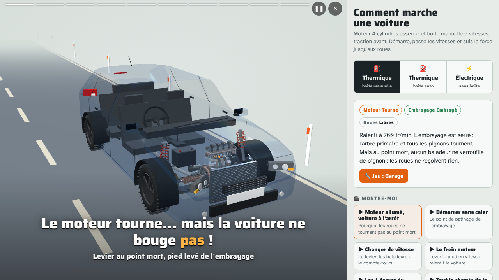

# Comment marche une voiture 🚗

**Un modèle 3D interactif pour comprendre ce qui se passe sous le capot**, du piston jusqu'à la route. Pour les ados, les élèves de l'auto-école et les curieux.

👉 **[Ouvrir la page](https://cornelcroi.github.io/comment-marche-une-voiture/)** (fonctionne sur téléphone, sans compte)



## Ce qu'on peut faire

- **3 voitures** : thermique avec **boîte manuelle**, thermique avec **boîte automatique**, et **électrique**.
- **Conduire** : démarrer, embrayer, passer les vitesses, freiner. Le compte-tours, le bruit et toutes les pièces réagissent. On peut même caler !
- **Toucher n'importe quelle pièce** (piston, bougie, disque d'embrayage, baladeur, onduleur…) pour savoir à quoi elle sert. **« Voir seule »** l'isole, et on zoome là où l'on pointe.
- **🎬 Montre-moi** : de petites vidéos automatiques, avec zooms, pointeur et sous-titres, chacune sur une idée :
  - Moteur allumé mais voiture à l'arrêt : pourquoi ?
  - Démarrer sans caler
  - Changer de vitesse
  - Le frein moteur
  - Les 4 temps du moteur
  - P, R, N, D en boîte automatique
  - Comment avance une voiture électrique
  - Freiner en rechargeant
  - Pourquoi l'électrique n'a pas de boîte de vitesses
- **✨ Vue simple** : seulement moteur, boîte et roues, pour voir le chemin de la force.
- **🔧 Jeu Garage** : une panne arrive (bougie, courroie, batterie, embrayage, cardan, onduleur…). Inspecte, trouve la pièce, répare, et compte tes étoiles.

## Comment c'est fait

Un seul fichier HTML, avec [three.js](https://threejs.org/) pour la 3D et une petite simulation physique (moteur, embrayage, convertisseur, moteur électrique, freinage régénératif).

- Les engrenages s'engrènent vraiment, dent contre dent.
- La boîte automatique suit un vrai schéma à trains épicycloïdaux.
- La carrosserie est une compacte générique.

C'est un **modèle simplifié pour apprendre**, pas un guide de réparation.

Le projet a été construit en conversation avec **Claude** (Anthropic), à partir d'une simple question d'un parent : « comment expliquer à mon fils ce qui se passe quand on démarre et qu'on passe une vitesse ? ».

## Ajouter une vidéo « Montre-moi »

Une vidéo n'est qu'une **liste de plans** : quelle pièce viser, quoi montrer, quelle action faire (embrayer, passer la 2e…) et quel sous-titre afficher. Pas besoin de toucher à la 3D.

- Format : [docs/SCENARIOS.md](docs/SCENARIOS.md)
- Liste des pièces : [docs/PARTS.md](docs/PARTS.md)
- Pour les assistants de code (Claude Code, Codex…) : [CLAUDE.md](CLAUDE.md)

Tu peux demander à un assistant : *« Ajoute une vidéo Montre-moi qui explique pourquoi on débraye avant de s'arrêter »*. Il a tout ce qu'il faut.

```bash
npm install && npx playwright install chromium   # une seule fois, pour les tests
npm run build    # src/ → index.html
npm test         # vérifie que tout se charge et que les vidéos se lancent
npm run serve    # http://localhost:8080
```

## Publier sur GitHub Pages

Settings → Pages → Source : *Deploy from a branch* → branche `main`, dossier `/ (root)`. La page est en ligne en une ou deux minutes.

## Licence

MIT. Libre de réutiliser, modifier et partager.

---

### English

**An interactive 3D model that shows how a car works**: petrol with a manual or automatic gearbox, and electric. You can drive it, tap any part to learn what it does, and watch short auto-directed « Montre-moi » videos (camera moves, pointer, captions). There's also a garage game where you find and repair a fault. The interface is in French.

It's a single static HTML file using three.js, built in conversation with Claude as a showcase. New videos are plain lists of shots (see `docs/SCENARIOS.md`), so an AI assistant can write them without touching the 3D code. MIT licensed.
